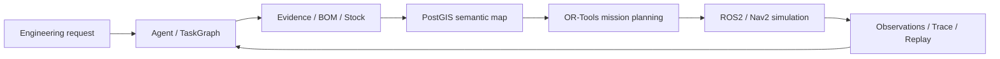

<div align="center">


# MaterialBrain

**Engineering materials intelligence, spatial planning and robot simulation in one Agent workspace.**

Connect engineering requests to datasheet-backed component choices, BOMs, stock locations and multi-stop robot missions.

[](https://github.com/Yvniverse/MaterialBrain-public/actions/workflows/public-ci.yml)
[](LICENSE)
[](docs/ROBOTICS.md)

[**中文文档**](README.zh-CN.md) · [Results](RESULTS.md) · [Architecture](docs/architecture/README.md) · [Planning](docs/SPATIAL_AGENT.md) · [Robotics](docs/ROBOTICS.md) · [Training](docs/architecture/06-model-training.md)

</div>


<div align="center"><sub>Research Logistics Lab · 3D equipment layout, spatial routes and mobile robot task state</sub></div>

<table><tr>
<td width="50%"><br/><sub>Aisle perspective · working areas and navigable corridors</sub></td>
<td width="50%"><br/><sub>Top-down perspective · route topology and stops</sub></td>
</tr></table>

## Measured results

**Qwen3.5-4B · 120 frozen critical-state recovery tasks**

Native GRPO + Anchor CE reached **120/120 task success** and **75/75 feasible capacity recovery** in both completed training seeds. Anchor-only and GRPO each used **2,304 supervised completion tokens and 16 optimizer steps**. The two GRPO seeds use the same 120 tasks and shared S/Anchor baselines.

| Metric | Recovery-SFT (S) | Anchor-only (A) | GRPO seed 08 | GRPO seed 14 |
| --- | ---: | ---: | ---: | ---: |
| Task success | 71/120 | 77/120 | **120/120** | **120/120** |
| Feasible capacity recovery | 35/75 | 32/75 | **75/75** | **75/75** |

Each GRPO seed improves on Anchor-only by **35.83 percentage points in task success** and **57.33 points in capacity recovery**, with **30/30 correct refusals** and **0/120 safety or authorization violations**. Tasks start at capacity-conflict, refusal and related decision states; task success includes successful execution, correct refusal and clarification.

**Spatial planning:** across **234 paired tasks feasible for both planners** in the fixed-seed benchmark, multi-stop planning reduced total route distance by **32.21%** relative to visiting stops in input order. [Spatial planning results](docs/results/SPATIAL_CPU.md)

**Full-mission Nav2 transfer:** S **6/12**, Anchor-only **6/12**, GRPO **3/12**. The critical-state gain did not transfer to this evaluation. [Scenarios and failure analysis](docs/results/CAREER_20261013_SUPPLEMENT.md)

[**Results and methods →**](RESULTS.md) · [Four-arm chart and data](docs/results/CAREER_20261013_SUPPLEMENT.md) · [Earlier Frozen120 study](docs/results/README.md)

## Robot missions, replanning and handoff

<table><tr>
<td width="33%"><br/><sub>Robot-follow view</sub></td>
<td width="33%"><br/><sub>Dynamic route recovery</sub></td>
<td width="33%"><br/><sub>Station arrival and scan handoff</sub></td>
</tr></table>

## From engineering request to warehouse execution

MaterialBrain is a self-hosted application for engineering materials and spatial tasks. **LangGraph + Qwen connect 29 typed tools** for component selection, BOM analysis, inventory lookup and mission planning. Server-side services validate material facts, permissions, inventory transactions and task state. The workbench and floating assistant share conversation state across the workspace.



| Capability | In the application |
| --- | --- |
| **Engineering Material Agent** | Compare components using datasheet evidence, electrical constraints, stock positions and BOM requirements; develop power and cable solutions. |
| **Inventory & Storage** | Manage materials, reservations and authorized stock transactions; inspect exact slots in the 100-drawer cabinet, 56-bin organizer and six-level shelf. |
| **Semantic Digital Twin** | Explore the Three.js warehouse, select equipment, locate storage slots and preview routes. |
| **Spatial Mission Planning** | Plan multi-stop tasks on a versioned PostGIS map with **219 nodes and 1,122 directed edges**, subject to payload, time-window, battery and route constraints. |
| **TaskGraph & Robotics** | Follow typed skills through navigation, scan/handoff, cancellation and replanning; execute ROS2 Jazzy / Nav2 simulation with State Lattice, MPPI and Behavior Tree recovery. |
| **WarehouseBench & Post-training** | Generate verified expert decisions, train LoRA SFT adapters, and explore the measured GRPO + Anchor study. |

## Engineering and inventory workspace

<table><tr>
<td width="50%"><br/><sub>Engineering material intelligence</sub></td>
<td width="50%"><br/><sub>Digital twin of registered storage locations</sub></td>
</tr></table>

The stockroom twin reflects registered drawers, bins, shelves and storage locations. The Research Logistics Lab is a versioned synthetic environment for multi-stop planning and ROS2/Nav2 execution. The application records planned routes and observed robot events separately.

## Technology

| Layer | Core technologies |
| --- | --- |
| Frontend | Vue 3, TypeScript, Element Plus, Three.js, ECharts |
| API & services | FastAPI, SQLAlchemy, PostgreSQL 17, PostGIS |
| Agent & planning | LangGraph, Qwen, typed tools, OR-Tools |
| Robotics | ROS 2 Jazzy, Nav2 State Lattice, MPPI, Behavior Tree |
| Training & evaluation | WarehouseBench, PyTorch / PEFT LoRA SFT, Agent Lightning SDK, native GRPO, Anchor CE, deterministic verification and replay |

Stock changes use authorized inventory transactions. Robot missions run in **ROS2/Nav2 simulation**, with `hardware_control=false` and `inventory_written=false`.

## Quick start

Requires Docker Engine and Compose v2. Source development uses Python 3.12, Node.js 22 and pnpm 11.

```bash
git clone --branch main https://github.com/Yvniverse/MaterialBrain-public.git
cd MaterialBrain-public
cp .env.example .env
```

Set `POSTGRES_PASSWORD` and update the matching password in `DATABASE_URL` in `.env`; URL-encode characters with special meaning in a URL. The default project is `materialbrain_public_v02`, the browser port is `18080`, and local file storage is `./storage`.

```bash
docker compose -p materialbrain_public_v02 up -d --build
docker compose -p materialbrain_public_v02 exec backend python scripts/create_admin.py
docker compose -p materialbrain_public_v02 exec backend python scripts/register_spatial_map.py --expected-database-name materialbrain_public
```

The backend applies migrations at startup. Open [http://localhost:18080](http://localhost:18080), sign in and change the initial password. Sample-map registration adds `MB-EMB-LAB-03` as an inactive map and preserves inventory. If you change `POSTGRES_DB`, use the same name in `--expected-database-name`.

For the optional ROS2/Nav2 simulator:

```bash
docker compose -p materialbrain_public_v02 --profile robotics up -d --build robotics
```

The simulator uses ROS domain `147` and internal bridge port `8766`. Check its readiness before starting a mission. Deterministic spatial queries and planning work without model credentials. To use the natural-language Agent entrypoint, set `AGENT_ENABLED=true` in `.env` and recreate the backend:

```bash
docker compose -p materialbrain_public_v02 up -d backend
```

Spatial requests use deterministic services; optional server-side model credentials enable model-assisted business requests. See [Deployment](docs/DEPLOYMENT.md) and [Robotics](docs/ROBOTICS.md) for configuration and simulation operation.

### Try the sample warehouse

The gallery uses synthetic inventory and equipment. For a fresh development installation, set `ENVIRONMENT=development` in `.env` and recreate the backend. Review the seed plan, then apply it to the explicitly named database:

```bash
docker compose -p materialbrain_public_v02 up -d backend
docker compose -p materialbrain_public_v02 exec -e SAMPLE_DATA_SEED_ENABLED=true backend python scripts/seed_sample_warehouse.py --expected-database-name materialbrain_public
docker compose -p materialbrain_public_v02 exec -e SAMPLE_DATA_SEED_ENABLED=true backend python scripts/seed_sample_warehouse.py --expected-database-name materialbrain_public --apply
```

The additive seed creates sample materials, storage locations, BOMs and synthetic stock in `development` and `test` environments. See [Deployment](docs/DEPLOYMENT.md) for sample-data setup.

## Reproduce and extend

- **Results:** [Measured results and methods](RESULTS.md), including critical-state recovery, full-mission transfer and earlier experiments.
- **Architecture:** [System components](docs/architecture/README.md) and [typed Agent orchestration](docs/AGENT_ARCHITECTURE.md).
- **Planning:** [PostGIS maps, route constraints and mission lifecycle](docs/SPATIAL_AGENT.md).
- **Robotics:** [Nav2 setup and scenarios](docs/ROBOTICS.md).
- **Training:** [WarehouseBench generation, replay and portable SFT](docs/WAREHOUSEBENCH.md) and [model training design](docs/architecture/06-model-training.md).
- **API & development:** [Authentication and endpoints](docs/API.md) and [contributor workflow](CONTRIBUTING.md).

Install the backend requirements, then run the deterministic planning benchmark from `backend/`:

```bash
python -m warehouse_bench --seed 17 --repetitions 3 --output ../storage/benchmarks/planners
```

Model weights and generated datasets are stored outside committed source. The optional training entrypoint uses an existing local compatible model directory.

## License

The application and documentation use [Apache License 2.0](LICENSE). The ROS2 subpackage retains its [MIT license](robot_bridge/ros2/LICENSE); additional notices are in [NOTICE](NOTICE) and [Assets](docs/ASSETS.md).
