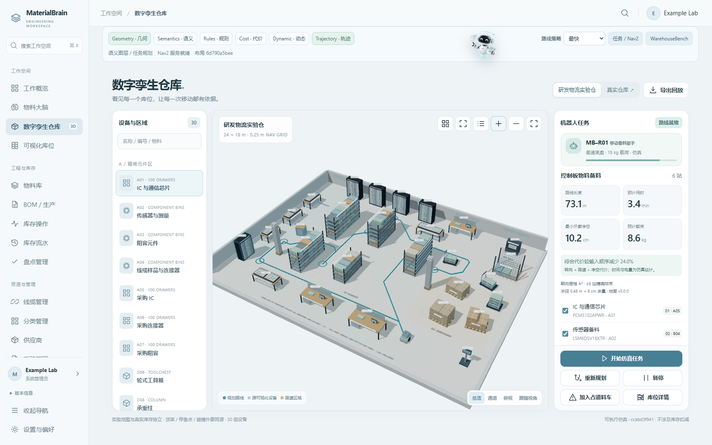
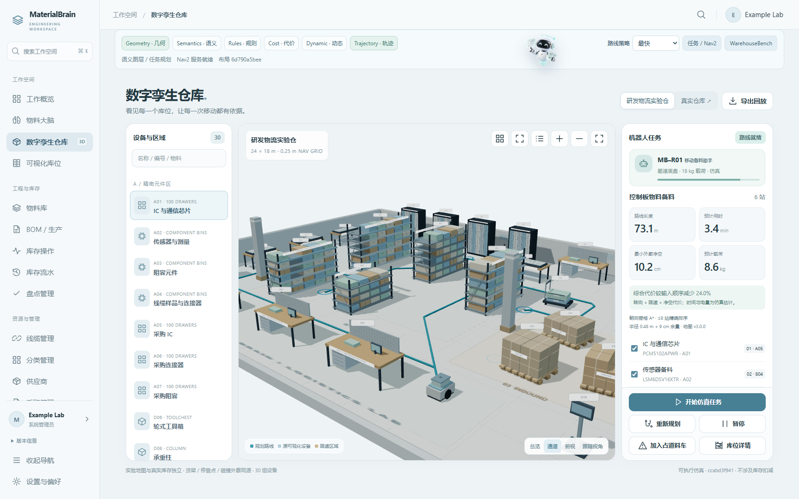
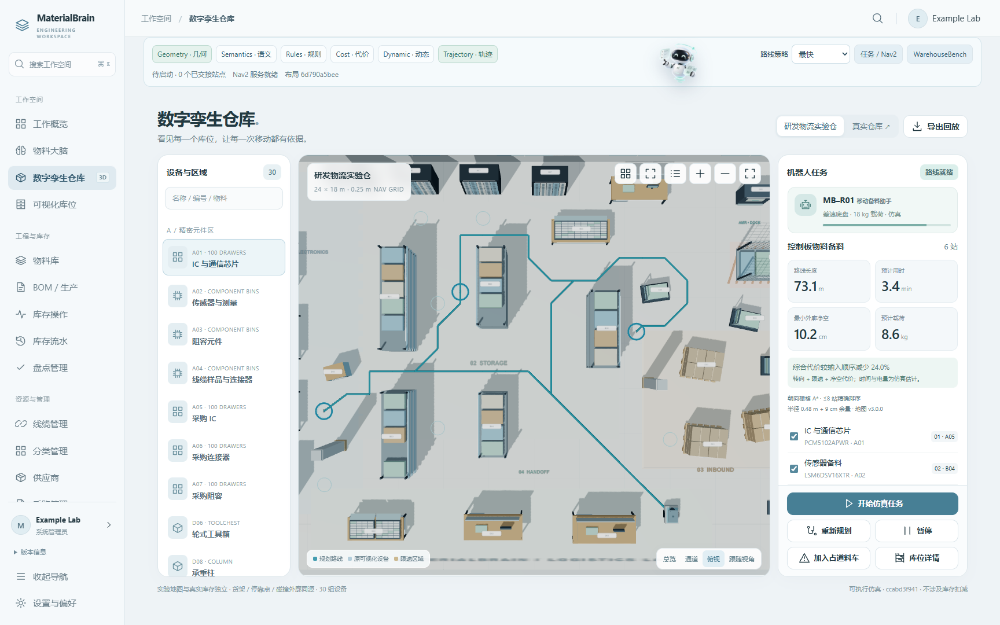
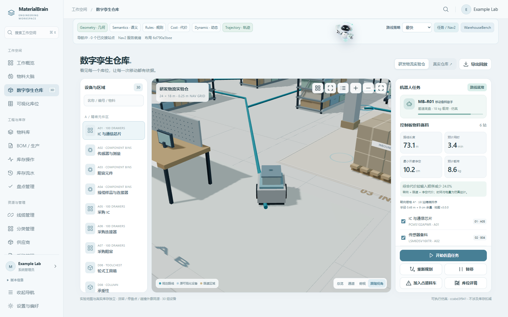
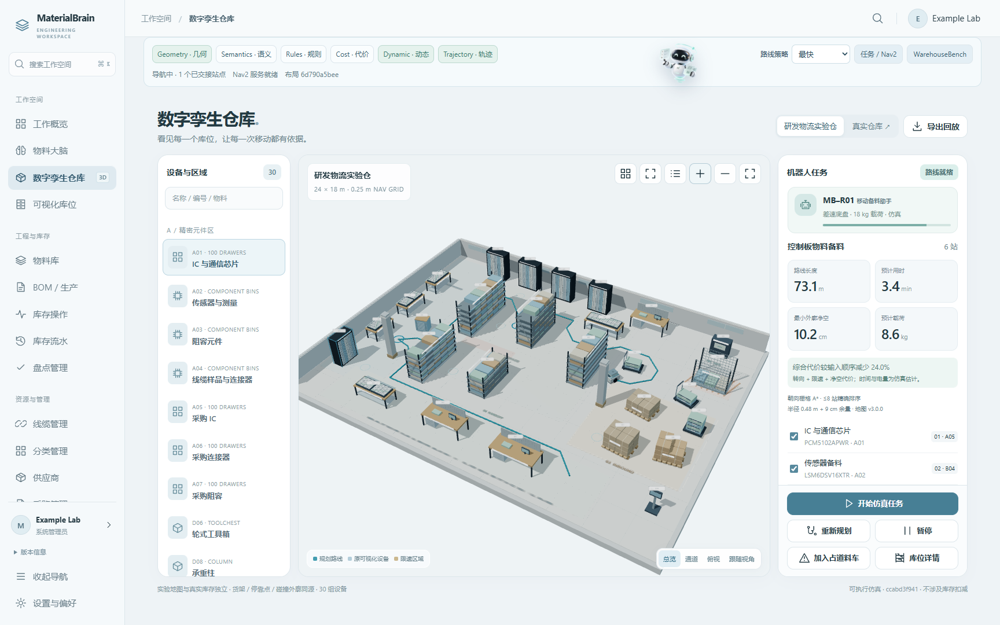
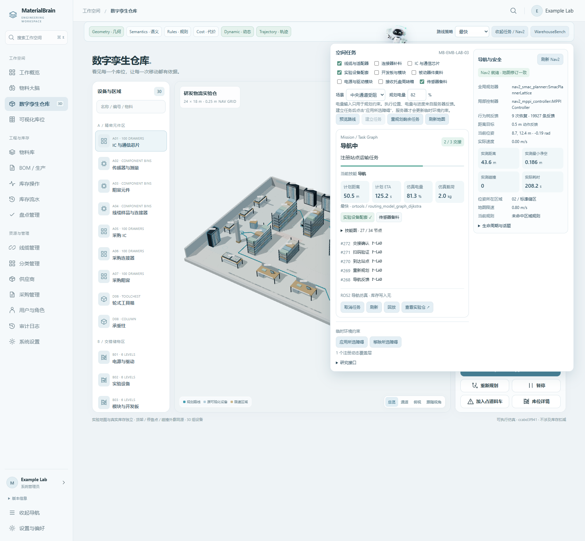
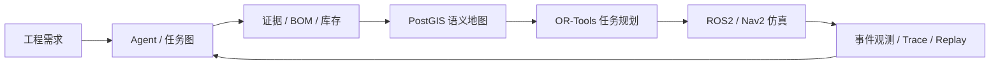
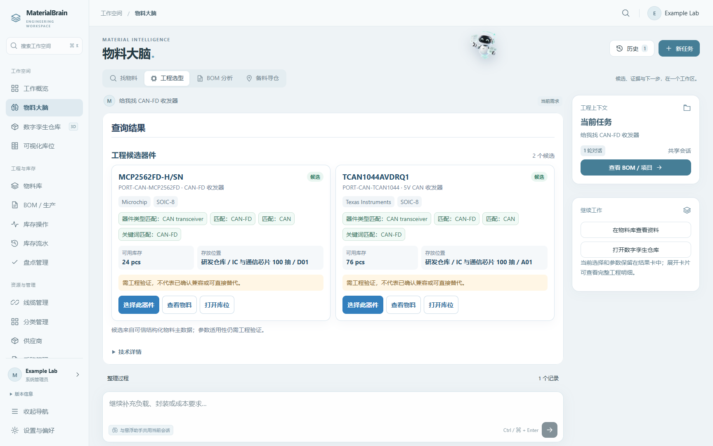
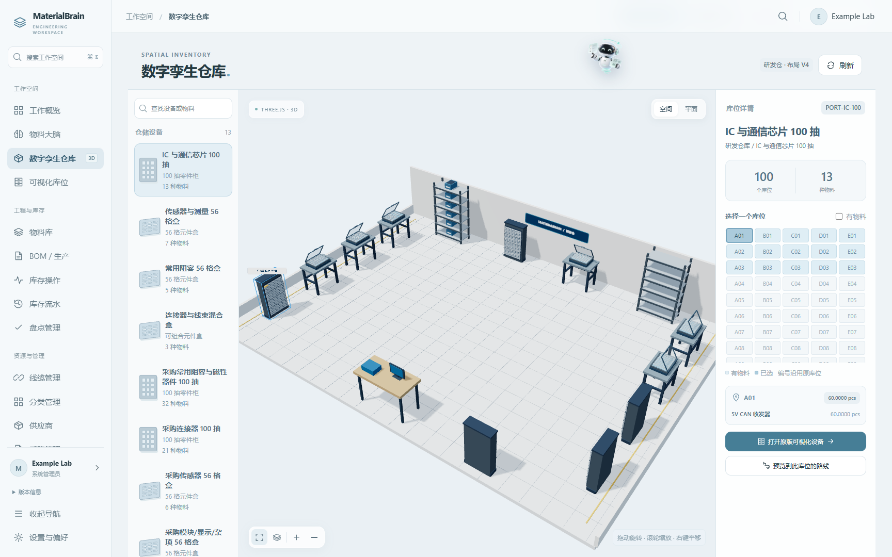

<div align="center">


# MaterialBrain

**连接工程物料决策、空间规划与机器人仿真的仓储 Agent。**

从工程需求出发，结合数据手册证据完成器件选型与 BOM 设计，联查库存库位，再规划多站机器人任务。

[](https://github.com/Yvniverse/MaterialBrain-public/actions/workflows/public-ci.yml)
[](LICENSE)
[](docs/ROBOTICS.md)

[**English**](README.md) · [Results](RESULTS.md) · [架构](docs/architecture/README.md) · [空间规划](docs/SPATIAL_AGENT.md) · [机器人](docs/ROBOTICS.md) · [训练](docs/architecture/06-model-training.md)

</div>


<div align="center"><sub>研发物流实验仓 · 多类型仓储设备、空间路线与移动机器人任务状态</sub></div>

<table><tr>
<td width="50%"><br/><sub>通道视角 · 设备布局和通行走廊</sub></td>
<td width="50%"><br/><sub>俯视视角 · 路径拓扑与停靠点</sub></td>
</tr></table>

## 量化结果

**Qwen3.5-4B · 120 项冻结关键状态恢复任务**

Native GRPO + Anchor CE 在两个完成训练的随机种子上，均取得 **120/120 任务成功**和 **75/75 可行容量恢复**。Anchor-only 与 GRPO 各使用 **2,304 个监督 completion tokens、16 个优化步骤**。两组 GRPO 在同一批 120 项任务上评测，共享 S／Anchor 对照。

| 指标 | Recovery-SFT（S） | Anchor-only（A） | GRPO 种子 08 | GRPO 种子 14 |
| --- | ---: | ---: | ---: | ---: |
| 任务成功 | 71/120 | 77/120 | **120/120** | **120/120** |
| 可行容量恢复 | 35/75 | 32/75 | **75/75** | **75/75** |

两组 GRPO 相对 Anchor-only 均提升 **35.83 个百分点的任务成功率**、**57.33 个百分点的容量恢复率**，保持 **30/30 正确拒绝**，安全／越权事件各为 **0/120**。任务从容量冲突、拒绝等决策状态开始，成功判定包含执行成功、正确拒绝与正确澄清。

**空间规划：** 在固定种子基准的 **234 组双方可行配对任务**上，多站路径规划相对按输入顺序执行，将总路径距离降低 **32.21%**。[空间规划评测结果](docs/results/SPATIAL_CPU.md)

**完整任务 Nav2 转移：** S **6/12**、Anchor-only **6/12**、GRPO **3/12**；该轮完整任务评测未复现关键状态恢复的增益。[场景与失败分析](docs/results/CAREER_20261013_SUPPLEMENT.md)

[**Results：量化结果与方法 →**](RESULTS.md) · [四臂图表与数据](docs/results/CAREER_20261013_SUPPLEMENT.md) · [较早的 Frozen120 实验](docs/results/README.md)

## 机器人移动、动态重规划与交接

<table><tr>
<td width="33%"><br/><sub>机器人运动与跟随相机</sub></td>
<td width="33%"><br/><sub>动态障碍与任务恢复</sub></td>
<td width="33%"><br/><sub>到站与扫码交接</sub></td>
</tr></table>

## 从工程需求到仓储执行

MaterialBrain 将工程物料智能与空间任务整合到一套可自托管应用中。**LangGraph + Qwen 编排 29 项类型化工具**，贯通器件选型、BOM 分析、库存查询和任务规划；服务端校验物料事实、权限、库存事务与任务状态。工作台和悬浮助手在工作空间中共享对话状态。



| 模块 | 产品能力 |
| --- | --- |
| **工程物料大脑** | 依据数据手册证据、电气约束、库存库位与 BOM 要求比较器件，生成电源与线缆方案。 |
| **库存与可视化库位** | 管理物料、预留和授权库存事务，定位 100 抽柜、56 格元件盒及六层货架中的精确库位。 |
| **三维数字孪生仓库** | 使用 Three.js 浏览仓库，选中设备、定位库位并预览路线。 |
| **约束空间规划** | 在 **219 节点、1,122 条有向边**的版本化 PostGIS 地图上，规划受载荷、时间窗、电量和通行约束的多站任务。 |
| **任务图与机器人执行** | 通过类型化技能连接导航、扫码交接、取消和重规划，以 State Lattice、MPPI 与 Behavior Tree 运行 ROS2 Jazzy / Nav2 仿真。 |
| **WarehouseBench 与后训练** | 生成可验证专家决策，训练本地模型 LoRA SFT 适配器，查看已完成的 GRPO + Anchor 实验结果。 |

## 工程物料与库位工作空间

<table><tr>
<td width="50%"><br/><sub>工程物料智能与证据化选型</sub></td>
<td width="50%"><br/><sub>注册仓储设备与精确库位</sub></td>
</tr></table>

库位数字孪生呈现已注册的抽屉柜、元件盒、货架与库位。研发物流实验仓使用版本化合成场景进行多站规划和 ROS2/Nav2 执行，应用分别记录规划路线与机器人事件观测。

## 技术栈

| 层级 | 主要技术 |
| --- | --- |
| 前端 | Vue 3、TypeScript、Element Plus、Three.js、ECharts |
| 后端与服务 | FastAPI、SQLAlchemy、PostgreSQL 17、PostGIS |
| Agent 与规划 | LangGraph、Qwen、类型化工具、OR-Tools |
| 机器人 | ROS 2 Jazzy、Nav2 State Lattice、MPPI、Behavior Tree |
| 训练与评测 | WarehouseBench、PyTorch / PEFT LoRA SFT、Agent Lightning SDK、Native GRPO、Anchor CE、确定性验证与轨迹重放 |

库存变化通过授权库存事务完成。机器人任务运行在 **ROS2/Nav2 仿真**中，`hardware_control=false`、`inventory_written=false`。

## 快速开始

需要 Docker Engine 和 Compose v2。源码开发使用 Python 3.12、Node.js 22 与 pnpm 11。

```bash
git clone --branch main https://github.com/Yvniverse/MaterialBrain-public.git
cd MaterialBrain-public
cp .env.example .env
```

在 `.env` 中设置 `POSTGRES_PASSWORD`，同步修改 `DATABASE_URL` 的密码；具有 URL 特殊含义的字符需要进行 URL 编码。默认项目为 `materialbrain_public_v02`，浏览器端口为 `18080`，本地文件保存在 `./storage`。

```bash
docker compose -p materialbrain_public_v02 up -d --build
docker compose -p materialbrain_public_v02 exec backend python scripts/create_admin.py
docker compose -p materialbrain_public_v02 exec backend python scripts/register_spatial_map.py --expected-database-name materialbrain_public
```

后端会在启动时应用数据库迁移。打开 [http://localhost:18080](http://localhost:18080)，登录并修改初始密码。示例地图注册命令加入未激活的 `MB-EMB-LAB-03` 地图，保留现有库存。如果修改了 `POSTGRES_DB`，请在 `--expected-database-name` 中使用同一名称。

需要可选 ROS2/Nav2 仿真时：

```bash
docker compose -p materialbrain_public_v02 --profile robotics up -d --build robotics
```

仿真器使用 ROS domain `147` 和内部 bridge 端口 `8766`。启动任务前先检查就绪状态。确定性空间查询与规划不需要模型凭据。使用自然语言 Agent 入口时，在 `.env` 中设置 `AGENT_ENABLED=true`，再重建后端容器：

```bash
docker compose -p materialbrain_public_v02 up -d backend
```

空间请求由确定性服务处理；可选服务端模型凭据用于模型辅助的业务请求。配置与仿真运行说明见 [部署](docs/DEPLOYMENT.md) 和 [机器人执行](docs/ROBOTICS.md)。

### 体验示例仓库

图库使用合成库存与仓储设备。在新的开发安装中，将 `.env` 的 `ENVIRONMENT` 设为 `development`，再重建后端容器。先检查初始化计划，再将数据写入明确指定的数据库：

```bash
docker compose -p materialbrain_public_v02 up -d backend
docker compose -p materialbrain_public_v02 exec -e SAMPLE_DATA_SEED_ENABLED=true backend python scripts/seed_sample_warehouse.py --expected-database-name materialbrain_public
docker compose -p materialbrain_public_v02 exec -e SAMPLE_DATA_SEED_ENABLED=true backend python scripts/seed_sample_warehouse.py --expected-database-name materialbrain_public --apply
```

加性初始化会在 `development` 与 `test` 环境创建示例物料、库位、BOM 和合成库存。样例数据配置见 [部署](docs/DEPLOYMENT.md)。

## 运行与扩展

- **结果：** [量化结果与实验方法](RESULTS.md)，含关键状态恢复、完整任务转移与历史实验。
- **架构：** [系统组件](docs/architecture/README.md) 与 [类型化 Agent 编排](docs/AGENT_ARCHITECTURE.md)。
- **规划：** [PostGIS 地图、路线约束与任务生命周期](docs/SPATIAL_AGENT.md)。
- **机器人：** [Nav2 配置与运行场景](docs/ROBOTICS.md)。
- **训练：** [WarehouseBench 生成、重放与可移植 SFT](docs/WAREHOUSEBENCH.md) 与 [模型训练设计](docs/architecture/06-model-training.md)。
- **API 与开发：** [认证与接口](docs/API.md) 和 [贡献流程](CONTRIBUTING.md)。

安装后端依赖后，从 `backend/` 运行确定性规划基准：

```bash
python -m warehouse_bench --seed 17 --repetitions 3 --output ../storage/benchmarks/planners
```

模型权重和生成的数据集保存在提交源码之外。可选训练入口使用已准备好的本地兼容模型目录。

## 许可证

应用与文档使用 [Apache License 2.0](LICENSE)。ROS2 子包保留 [MIT license](robot_bridge/ros2/LICENSE)；其他说明见 [NOTICE](NOTICE) 和 [素材](docs/ASSETS.md)。
