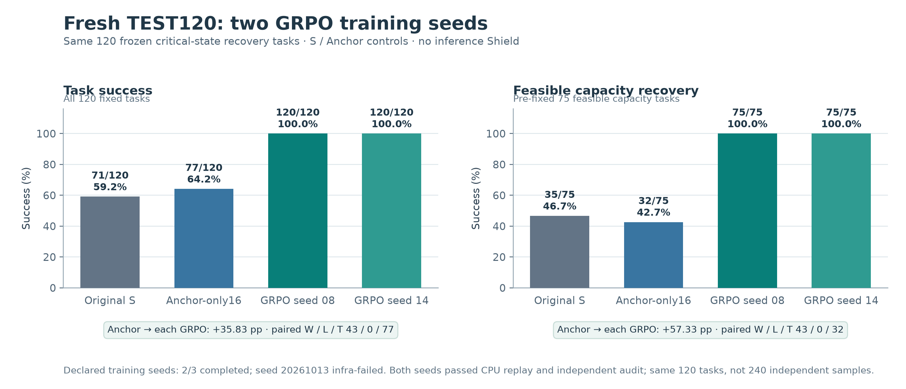
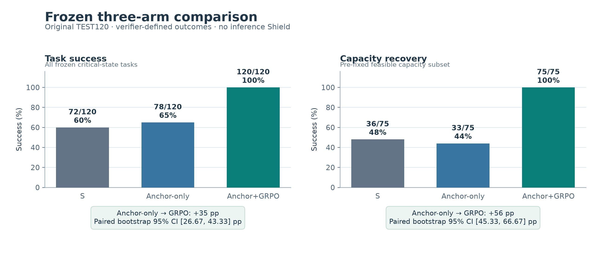

# MaterialBrain Results

MaterialBrain 将工程 BOM、批次库存、PostGIS 仓库地图、OR-Tools 约束规划和 ROS2/Nav2 仿真接成可审计的仓储 Agent。模型选择结构化动作；服务器验证权限、业务事实、任务依赖和执行反馈。系统提供 **29 个类型化工具**，实验室语义图包含 **219 个节点、1,122 条有向边**。[空间规划数据](docs/results/SPATIAL_CPU.md)

## 新一轮冻结 TEST120：四臂聚合结果

新一组 **120 项固定关键状态恢复任务**比较原始 S、Anchor-only16、原始 GRPO 种子和新训练 GRPO 种子。匹配的 Anchor／GRPO 训练臂各用 **2,304 个监督 completion tokens、16 个优化步骤**，TEST 推理无 Shield、无优化更新。两次 GRPO 推理使用同一组 120 个输入，S／Anchor 是共享对照条件；不能合并说成 240 个独立任务。[四臂 CSV](docs/results/FRESH_TEST120_ARMS.csv) · [证据身份与独立审计](docs/results/FRESH_TEST120_AGGREGATE.json)

| 新鲜 TEST120 | 原始 S | Anchor-only16 | GRPO 种子 08 | GRPO 种子 14* |
|---|---:|---:|---:|---:|
| Task Success | 71/120 | 77/120 | **120/120** | **120/120** |
| 可行容量恢复 | 35/75 | 32/75 | **75/75** | **75/75** |
| CAP／DEAD 正确拒绝 | 15/15 · 6/15 | 15/15 · 15/15 | **15/15 · 15/15** | **15/15 · 15/15** |
| Safety／Unauthorized episode | 0 · 0 | 0 · 2 | **0 · 0** | **0 · 0** |

两组已完成训练种子均通过正式 CPU 重放及独立统计审计。各自对 Anchor 的 Task 提升 **35.83pp**（同任务 43 胜／0 负／77 平，paired bootstrap 95% CI 均为 **27.5–45pp**），容量恢复提升 **57.33pp**（43／0／32，CI 均为 **46.67–68pp**）；各自两项 exact 双侧 McNemar p 均为 **2.2737367544323206e-13**。独立审计对六臂执行的 **720 条终态记录**和两个各 23 文件的归档做了核查，四份保存的配对报告每项统计均一致；重复执行的 S／Anchor 同组记录差异为 **0/120**。这是一组 120 项固定任务上的两个训练种子结果，不估计训练种子间方差。训练种子事前声明 **3** 个，原始 08 与新增 14 完成；13 在 1/16 个优化步骤后基础设施中断，没有合格 checkpoint 或 TEST。

[可缩放 SVG](docs/results/figures/fresh_test120_four_arm.svg) · [图表生成脚本](docs/results/figures/make_fresh_test_figure.py) · [方法与 Nav2 转移结果](docs/results/CAREER_20261013_SUPPLEMENT.md)

## 原始 Frozen120：先前验证

从同一个 Qwen3.5-4B Recovery-SFT 检查点出发，比较原始 S、只做保留监督的 Anchor-only16、以及相同监督加 GRPO16。两个正式训练臂都使用 **2,304 个监督 completion tokens、16 个优化步骤**。按独立 VAL 预选 checkpoint 后，进行一次无 Shield 的冻结 **120 项关键状态任务**评测。[方法与原始聚合数据](docs/results/README.md)

| 冻结 TEST120 | 原始 S | Anchor-only16 | Anchor+GRPO16 |
|---|---:|---:|---:|
| Task Success | 72/120 | 78/120 | **120/120** |
| 可行容量冲突恢复 | 36/75 | 33/75 | **75/75** |
| CAP／DEAD 正确拒绝 | 15/15 · 6/15 | 15/15 · 15/15 | **15/15 · 15/15** |
| Safety／Unauthorized episode | 0 · 0 | 0 · 3 | **0 · 0** |

主对照 **Anchor-only16 → Anchor+GRPO16** 的 Task Success 提升 **35 个百分点**（同任务配对 42 胜／0 负／78 平；95% CI 26.67–43.33pp），容量恢复提升 **56 个百分点**（42／0／33；95% CI 45.33–66.67pp）。120 个判定成功中，**87 个为执行成功、30 个为正确拒绝、3 个为正确澄清**。[三臂 CSV](docs/results/THREE_ARM_FROZEN_TABLE_B.csv) · [配对 JSON](docs/results/FROZEN_COMPARISON_B.json) · [离线核对脚本](docs/results/verify_tables.py)

[可缩放 SVG 图](docs/results/figures/frozen_three_arm.svg) · [作图输入、脚本与 SHA256](docs/results/figures/FIGURE_MANIFEST.json)

固定种子的 **1,000 项 CPU 规划**另外得到 **791 个独立审计可行解、0 个约束违规**，请求内规划 p50/p95 为 **406/622 ms**。这项规划结果与模型 TEST 分开计量。[规划完整口径](docs/results/SPATIAL_CPU.md)

## VAL 选择、完整任务转移与路线诊断

[独立增补、CSV 与证据哈希](docs/results/CAREER_20261013_SUPPLEMENT.md)将新鲜 VAL64、从 HOME 开始的 Nav2 完整任务和路线诊断分开报告。预先声明的三个训练种子中两个完成；20261013 种子在 1/16 个优化步骤后因基础设施错误中断，不能算作成功复现。两个完成的 RL ck16 在同一选择集 VAL64 上各为 64/64，匹配 Anchor-ck16 为 40/64；这些是 **VAL 选择结果**，后续新鲜 TEST 原始计数与审计状态见上。

完整初始任务的 Nav2 仿真保留了 12 场景 × 3 臂的全部 36 次尝试：S、Anchor16、GRPO16 的 Task 分别为 **6/12、6/12、3/12**。匹配监督的 Anchor16→GRPO16 为 **−25pp**（同场景 1 胜／4 负／7 平）；关键状态后缀的增益没有在这次转移中重现。验证集路线诊断中三臂均为 12/12 完成、首次选路 10/12；GRPO 在两例封闭最快路线上的阻塞旅行共 28 次，对照各 2 次，不能解释为总体效率提升。失败、传输故障和测量分母见增补，结果不与 Frozen120 合并。

实验设计、机制与证据范围

两个正式臂使用相同 Anchor 顺序、监督量与优化步数；组合臂额外采样 16 组 G8、共 128 条真实多步训练轨迹，其中 12 步产生非零奖励梯度。TEST 无 Shield、无权重更新，三臂共 360 个 episode。完整动作轨迹由独立审计重放；本公开 packet 提供字节一致的聚合副本与 SHA，原始全量轨迹和权重另行保存。[方法与哈希](docs/results/METHODS.md)

[原始 16 步 TRAIN 诊断图](docs/results/figures/formal16_train_diagnostics.png)展示每步不同固定训练组的成功数、终端奖励方差、三项梯度和累计有效奖励更新；第 12、14、15、16 步奖励梯度为零。每步训练组不同，图中成功数不应解释为同一验证集的学习曲线。[SVG](docs/results/figures/formal16_train_diagnostics.svg) · [精简作图输入](docs/results/figures/training_curve_inputs.json)

保存轨迹的只读对齐显示：75 个容量任务中，原始 S 与 RL 的关键差异集中于最后返航 HOME 的 `route=safest→fastest`。39 个零时间余量任务从截止失败转为成功；其余 36 个原已成功。相对 Anchor-only 的 42 个胜利还包含修复其自身 3 个回退。这是观察性机制证据，未进行单参数反事实介入。[首个合格配对任务的原始动作顺序](docs/results/example/PAIRED_TRACE.md)展示 S 在截止 tick 36 后失败、RL 按时完成；[公共机制摘要](docs/results/MECHANISM_SUMMARY.json)汇总全体。

本次 120 项是注册模板家族内新场景种子的**关键状态后缀任务**；它不代表 120 次机器人配送。新增训练种子的完成／中断分母、本轮三臂 Nav2 负结果，以及新鲜 TEST 的证据状态见[独立增补](docs/results/CAREER_20261013_SUPPLEMENT.md)。

历史结果与负结果

旧 P3 在另一套已饱和基准上 Base14/120→SFT120/120，但旧正式 GRPO 有效奖励更新为 0，科学结论仍是 FAIL；旧 SFT 的 Nav2 仿真 12/12 属另一轮实验。Route A 在相同 PUBLIC-only Shield 下将 Task81/120 提到111/120，但模型 raw DEAD refusal 6/15→0/15，因此仅支持带保护层的系统改进。当前 Route B 的无 Shield、匹配监督对照单独回答模型增益。[历史与归因](docs/results/METHODS.md#历史结果与资源)

公开副本与验证说明：[docs/results/README.md](docs/results/README.md)。本页提供可离线核对的 CSV、JSON、源码身份和训练诊断图。
