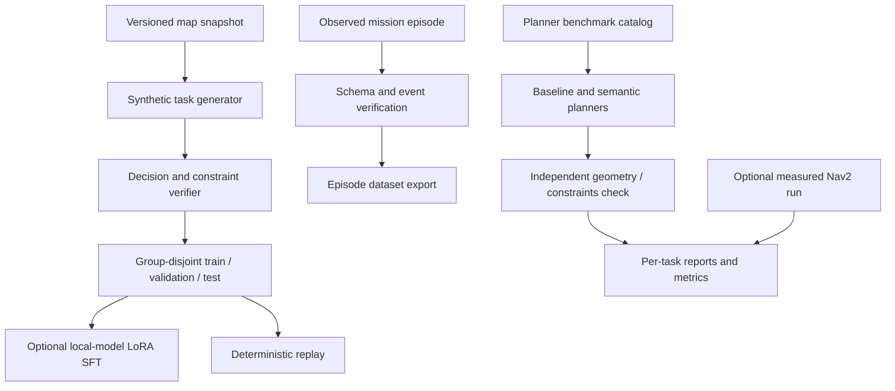

# Model training and evaluation

WarehouseBench provides planner tasks and independent route verification. The training interface generates synthetic decision records from a versioned snapshot. Observed mission episodes provide a separate replay source.

Synthetic decisions and observed execution are different data sources. A planned path is evaluated as a plan; measured execution requires recorded robot topics and events. Infeasibility classification, successful planning, and completed missions are reported separately.

The SFT entrypoint takes a local model path and generated data. Optional training dependencies are separate from application dependencies. Training receipts record the snapshot, input hashes, configuration, and checkpoints so runs can be compared.

Portable workflow source: [WarehouseBench](../../backend/warehouse_bench/), [episode exporter](../../backend/app/agent/spatial_agent/dataset.py), [training modules](../../training/materialbrain_training/), [SFT entrypoint](../../training/train_sft.py).

## Completed Qwen3.5-4B post-training study

The portable `training/train_sft.py` entrypoint above trains SFT adapters on generated WarehouseBench decisions. The completed Route B study used a separate Qwen3.5-4B Recovery-SFT checkpoint and native GRPO with completion-only Anchor supervision; the portable SFT command does not run those GRPO updates.

The Anchor-only control and Anchor+GRPO arm each used **2,304 supervised completion tokens and 16 optimizer steps**. On the **no-Shield frozen 120-task critical-state evaluation**, Task Success improved from **78/120 to 120/120 (+35pp)**, and feasible capacity recovery improved from **33/75 to 75/75 (+56pp)**. These verifier outcomes concern critical-state task suffixes, separately from robot mission completion.

[Results](../../RESULTS.md) · [Methods and evaluation scope](../results/METHODS.md) · [Three-arm CSV](../results/THREE_ARM_FROZEN_TABLE_B.csv) · [16-step TRAIN diagnostics](../results/figures/formal16_train_diagnostics.png)

Next: [WarehouseBench guide](../WAREHOUSEBENCH.md)
